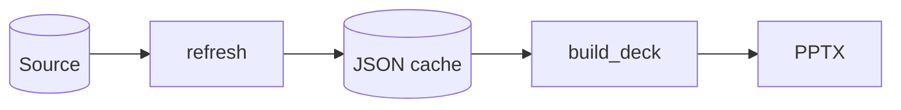

# Automated report pipeline: data model summary (synthetic exercise)

A daily slide deck built from a data source and delivered automatically. A fictional company with generated regions and values.

## Status
- Runs end to end: refresh, then deck. Both pytest checks pass.
- Not included: a real source, upload step, container image. The Airflow DAG is illustrative and not run.

## 1. Problem and process
Two stages so the deck can be rebuilt without hitting the source again: **refresh** (source -> JSON cache) and **build_deck** (cache -> PPTX with a native chart).

## 2. Data flow


## 3. Rules
- `REPORT_DUMMY=1` selects the synthetic source. Without it, `refresh` fails loudly instead of silently producing fake numbers.

## 4. Tests
| Check | Fails the run? |
|---|---|
| Refuses to run without the dummy flag | yes |
| Deck has the expected slides and a chart | yes |

## 5. Known issues and next steps
- Next: per-slide queries, a container, delivery to a shared drive, alerts on failure. `dags/report_dag.py` shows the schedule (daily, two retries).

## 6. How to run
```
$env:REPORT_DUMMY="1"
python pipeline.py        # writes output/report.pptx
python -m pytest -q
```
Needs python-pptx and pytest.

---
Part of the portfolio at https://astrenot.github.io/Arkananta-Website/. Synthetic data only.
